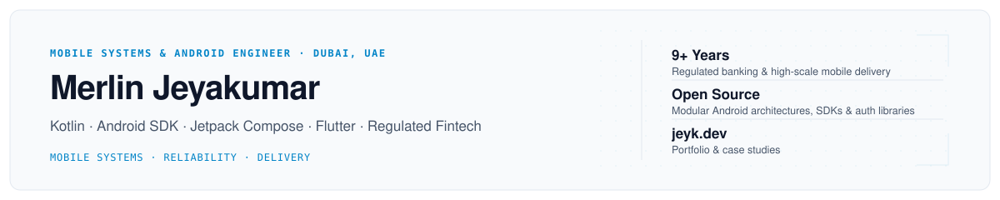

  <a href="https://www.jeyk.dev">
    <picture>
      <source media="(max-width: 520px) and (prefers-color-scheme: dark)" srcset="assets/header-dark-mobile.svg" />
      <source media="(max-width: 520px) and (prefers-color-scheme: light)" srcset="assets/header-light-mobile.svg" />
      <source media="(prefers-color-scheme: dark)" srcset="assets/header-dark.svg" />
      <source media="(prefers-color-scheme: light)" srcset="assets/header-light.svg" />
      
    </picture>
  </a>

  <a href="https://www.jeyk.dev">Portfolio: jeyk.dev</a> · <a href="https://ae.linkedin.com/in/merlin-jeyakumar">LinkedIn</a> · Dubai, UAE

Mobile Systems & Android Engineer with 9+ years across regulated banking and high-scale consumer apps. Focused on modular Kotlin, Jetpack Compose, Flutter architecture, security, and automated delivery.

## Featured open-source engineering

| Repository / project | Focus | What it solves | Stack |
| --- | --- | --- | --- |
| [kotlin-multi-module-mvvm-architecture-android](https://github.com/merlinJeyakumar/kotlin-multi-module-mvvm-architecture-android) | Architecture | Reference boundaries for modular, testable Android applications. | Kotlin · Android · Clean Architecture · DI · Coroutines · Flow |
| [JGoogleAuth](https://github.com/merlinJeyakumar/JGoogleAuth) | Android Library | Reusable Google Sign-In, Sheets, and Drive wrapper configured with Android `minSdk 21`, `compileSdk 33`, and `targetSdk 32`. | Kotlin · Activity Result API · Google APIs |
| [jeyksupport](https://github.com/merlinJeyakumar/jeyksupport) | Android SDK | Reusable Android foundations and helpers for results, binding, and device, file, and network utilities. | Kotlin · MVVM · ViewBinding |
| [One Tap FileShare](https://www.jeyk.dev/#work) | Networking / Utility | Local-network file transfer and multi-device developer workflow utilities. | Kotlin · FTP · Android · Android TV |

<strong>Engineering focus &amp; architecture principles</strong>

- **Mobile architecture** — Multi-module Clean Architecture, MVVM/MVI, Compose UI systems, Flutter, and shared native bridges.
- **Reliability &amp; performance** — Cold-start tuning, memory and crash profiling across broad device matrices, and staged rollouts.
- **Quality &amp; delivery** — TDD-minded practices, JUnit/Espresso automated testing, and GitHub Actions/Fastlane CI/CD.
- **Security &amp; domain** — Biometric step-up flows, certificate pinning, encrypted local storage, and regulated fintech workflows.

